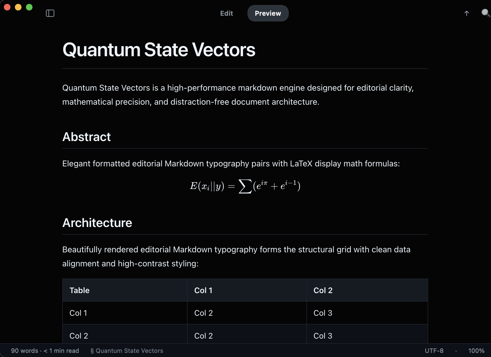

<p align="center">
  
</p>

<h1 align="center">Markd</h1>

<p align="center">
  <strong>Fast, native C++20 &amp; Qt 6 Markdown reader and editor for macOS, Windows, and Linux.</strong><br/>
  Opens technical specs, RFCs, equations, and architecture diagrams in under <strong>180 ms</strong> — zero Electron, zero cloud accounts, zero telemetry.
</p>

<p align="center">
  <a href="https://markd.aramudan.dev"><strong>Website</strong></a> ·
  <a href="#installation"><strong>Install</strong></a> ·
  <a href="#features"><strong>Features</strong></a> ·
  <a href="#systems-architecture"><strong>Architecture</strong></a> ·
  <a href="#building-from-source"><strong>Build</strong></a> ·
  <a href="LICENSE"><strong>GPL-3.0 License</strong></a>
</p>

---

<p align="center">
  
</p>

---

## Features

* **Instant Cold Start (`< 180 ms`):** Opens `.md` documents immediately from Finder, Explorer, or your terminal (`markd README.md`) with a native two-stage rendering pipeline — no multi-second Chromium splash wait.
* **Dual `Preview` & `Edit` Modes (`Cmd+E` / `Ctrl+E`):** Toggle effortlessly between distraction-free Obsidian-dark editorial typography and a clean, line-numbered monospace Markdown editor.
* **100% Offline Math & Diagrams:** Built-in **KaTeX** typesetting (`$...$` and `$$...$$` equations) and **Mermaid** flowcharts, sequence diagrams, and state machines with interactive pan and `0.2x–5.0x` zoom controls — zero network or CDN calls.
* **Code Presentation Cards:** **Highlight.js** syntax highlighting wrapped in structured code cards with language badges and one-click Copy-to-Clipboard.
* **Collapsible Table of Contents (`Cmd+\`) & Live Telemetry:** Synchronized document outline sidebar alongside a subtle bottom status bar displaying word count, reading time, active heading (`§`), character encoding, and zoom scale.
* **Live Disk Hot-Reload:** `QFileSystemWatcher` automatically re-renders open files the instant your external IDE, CLI script, or coding agent writes to disk while preserving your scroll position.
* **Single-Instance Multi-Window Workflow (`Cmd+\``):** Opening files from the shell or file manager reuses the running process over a `< 60 ms` local IPC socket, raising already-open documents instead of spawning duplicate processes or browser tabs.
* **In-Page Find & Rich Export:** Floating `Cmd+F` search bar across both Preview and Edit modes, **Export to Standalone HTML** (`Cmd+Shift+E`), **Print / Save to PDF** (`Cmd+P`), and **Copy as Rich HTML** (`Cmd+Shift+C`).
* **Automatic `.md` File Association:** Native OS file-type registration (`markd --register-default` or `File -> Make Default for Markdown`) binds `.md`, `.markdown`, `.mdown`, `.mkd`, and `markd://open?path=...` links across macOS LaunchServices, Windows Registry, and Linux `xdg-mime`.

---

## Installation

### macOS (Homebrew — Installs `/Applications/Markd.app`, `markd` CLI & `.md` Association)
```sh
brew install --cask nodesman/markd/markd
```
*(Or via Homebrew Formula: `brew install nodesman/markd/markd && markd --register-default`)*

### POSIX One-Liner (macOS & Linux)
```sh
curl -fsSL https://markd.aramudan.dev/install.sh | sh
markd --register-default
```

### Ubuntu / Debian (`APT`)
```sh
sudo apt-get update && sudo apt-get install -y markd
```

### Windows (PowerShell)
```powershell
irm https://markd.aramudan.dev/install.ps1 | iex
```

---

## Systems Architecture

* **Two-Stage Cold-Start Pipeline:**
  * **Stage 1 (`InstantPreviewSurface`):** Native `QTextBrowser` paints styled GitHub-flavored Markdown, centered `760px` editorial margins, and heading anchors in `< 120 ms` p95 before WebEngine loads.
  * **Stage 2 (Deferred `QLibrary` Hydration):** `libmarkd_webengine` (`QtWebEngineWidgets` + `QtWebChannel`) loads dynamically after the first native frame paints and transfers scroll ratio, zoom factor, Find-in-Page state, and keyboard focus without losing reading position.
* **Fast-Path CLI & Single-Instance IPC (`QLocalServer`):**
  * `--version`, `--help`, `--register-default`, and secondary file-open invocations execute before `QApplication` construction, forwarding paths over a per-user local socket in `< 60 ms` p95.
* **Hardened Offline DOM Pipeline:**
  * Pre- and post-Mermaid **DOMPurify** sanitization (`foreignObject` HTML label support with strict CSS positioning/`@import` and script scrubbing) running inside an off-the-record `NoCache` profile.
* **Engineering & Verification Standards:**
  * Modular C++20 coordinators (`<= 200` lines on strict modules), `100/100` Object Calisthenics enforcement, `20` headless `CTest` suites compiled with `-UNDEBUG`, and `96` JSDOM rendering specs at `100%` `c8` branch and line coverage.

---

## Building from Source

### Prerequisites
* **C++20 compiler:** Clang 15+ (macOS/Linux), GCC 12+ (Linux), or MSVC 2022 (Windows)
* **CMake:** `>= 3.16`
* **Qt 6 (`>= 6.5`):** `Core`, `Gui`, `Widgets`, `Network`, `WebChannel`, `WebEngineWidgets`, `Test`
* **Node.js (`>= 20`):** Optional — used only for running the headless JSDOM/coverage web test suite

### Configure, Build & Test (CMake)
```sh
cmake -B build -S . -DCMAKE_BUILD_TYPE=Release -DCMAKE_PREFIX_PATH="/path/to/Qt/6.5.3/macos/lib/cmake"
cmake --build build -j8
ctest --test-dir build --output-on-failure
```

### Run Web Rendering Tests (100% Branch & Line Coverage)
```sh
cd web
npm ci
npm run test:coverage
```

### Run Using `task` ([Taskfile](https://taskfile.dev))
```sh
task build          # Configure & compile Release binary + assertion-enabled CTest runner
task test           # Run decoupled C++ (CTest) and Web (Node/JSDOM) suites
task benchmark      # Verify p95 cold-start, CLI, and IPC latency budgets
task package-macos  # Build self-contained arm64 Markd.app, .dmg, and .tar.gz
```

---

## Repository Layout

```text
├── CMakeLists.txt       # C++20 build graph (markd binary + libmarkd_webengine plugin + test_cli)
├── Taskfile.yml         # Developer build, test, benchmark, and packaging automation
├── src/
│   ├── app/             # CLI fast-path parser, QApplication lifecycle, QLocalServer IPC
│   ├── bridge/          # Bidirectional QWebChannel C++ <-> DOM contract
│   ├── core/            # DocumentSession, live reload, file association, clipboard, updater
│   ├── parser/          # Markdown heading & Table-of-Contents slug parser
│   └── ui/              # InstantPreviewSurface, PreviewView, EditorView, TOC, platform chrome
├── web/                 # Offline Markdown-It + KaTeX + Mermaid renderer & 100%-covered test suite
├── resources/           # Obsidian QSS theme, app icons, showcase document, Qt resource manifests
├── scripts/             # Startup latency benchmarks, icon pipeline, Homebrew & macOS bundlers
└── tests/               # 20 headless C++20 BDD test suites
```

## License

Released under the [GNU General Public License v3.0 (GPL-3.0)](LICENSE). Copyright © 2026 Raj Aramudan.
